  

  

  
  
  

  

  

  <a href="https://www.linkedin.com/in/vedish">LinkedIn</a> &nbsp;/&nbsp; <a href="https://snowballgtm.com">Snowball</a>

<!-- Cards are drawn by scripts/build_cards.py and the graph is refreshed by .github/workflows/refresh-cards.yml. Do not edit the SVGs by hand. -->
